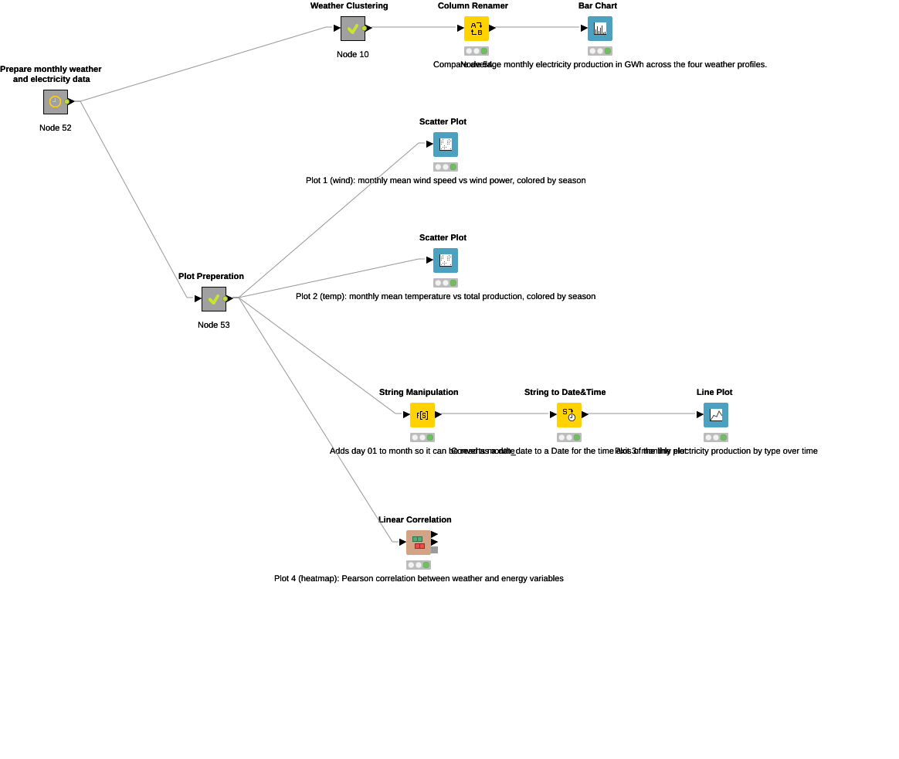
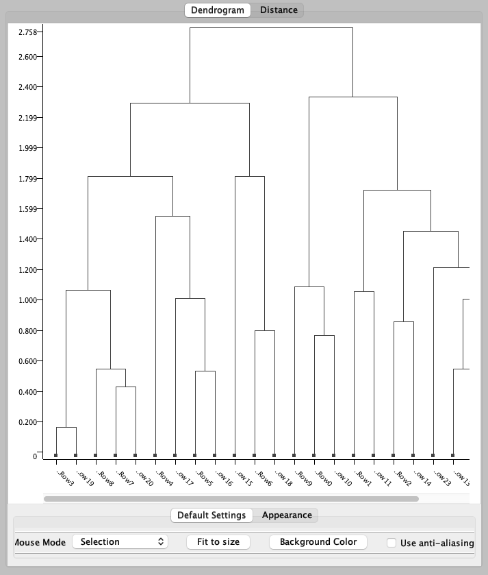
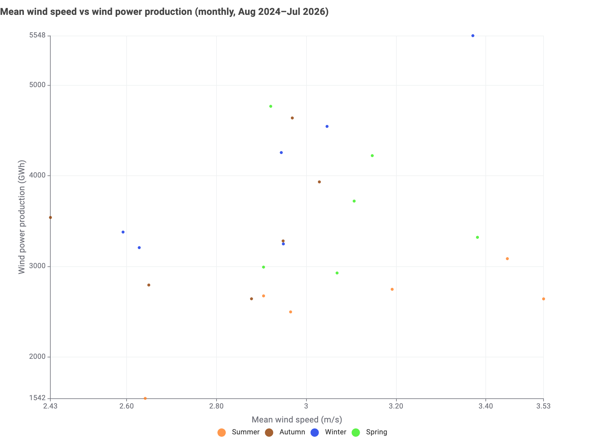
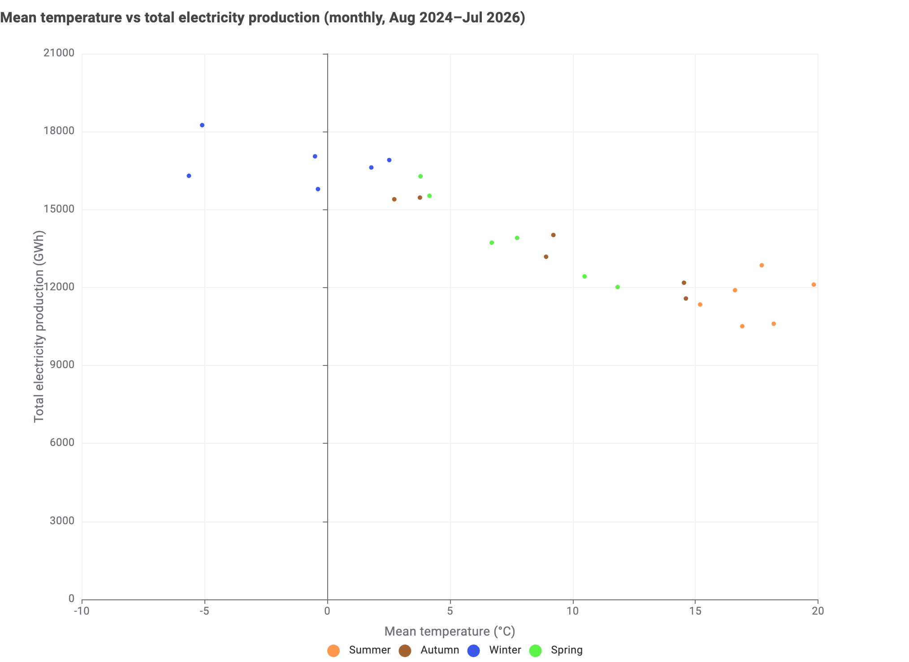
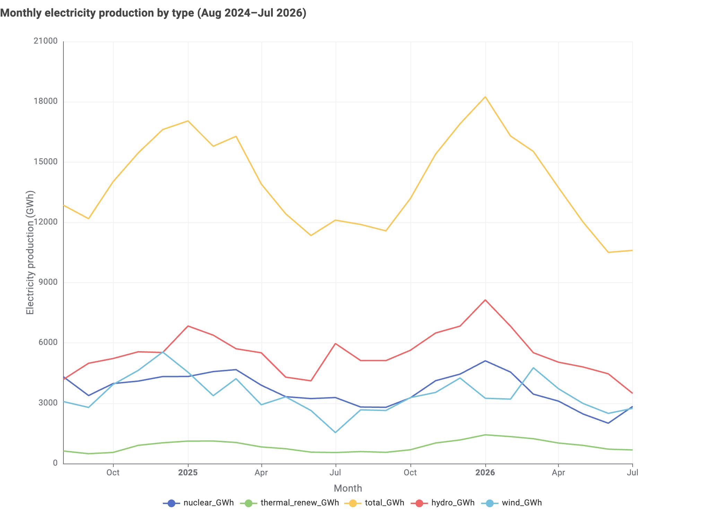

# Weather and Energy Production in Sweden

<!-- Group report. Sections: Introduction, Method, Results and discussion.
     Each section needs at least 200 words; whole report 600–1,000 words; 4–10 figures. -->

## Introduction and motivation

Weather conditions can have an important effect on electricity production in Sweden. As the country uses renewable energy sources such as hydropower and wind power, weather becomes an important factor in how much electricity can be generated. This study explores the relationship between monthly weather conditions and electricity production from August 2024 to July 2026. The aim is to identify possible patterns and seasonal changes rather than prove that weather causes changes in production.

Sweden produced about 168 TWh of electricity per year during the study period, almost entirely from low-carbon sources. Hydropower supplied about 39 % of the total, nuclear power 26 %, wind power 25 % and renewable thermal power about 6 %. Studying production month by month shows how these sources follow the seasons, which yearly totals would hide.

Three main weather variables were selected from SMHI: temperature, precipitation and wind speed. Temperature matters because colder weather increases the need for heating, which can raise electricity demand and production from thermal power plants. Precipitation contributes to water availability for hydropower, and wind speed influences how much electricity wind turbines can produce. Sunshine duration would be relevant for solar power, but it was not included in our dataset.

Four weather stations were selected to cover different parts of Sweden. Stockholm represents an important electricity consumption centre, Göteborg represents the windy west coast, Malmö covers the southern region where wind and solar power are relevant, and Luleå represents the north, where hydropower is important. The 24-month period includes two complete annual cycles, making seasonal comparisons possible.

## Method

Figure 1 shows the complete KNIME workflow.

**Figure 1 – Complete KNIME workflow**

### Weather data

Weather data were collected from the SMHI Meteorological Observations API as one corrected-archive CSV file per station and weather variable. A configuration table listing the 12 data series (four stations and three variables) controlled a loop that built each URL and downloaded the file. The data were then filtered to August 2024 - July 2026, checked for duplicates and checked against plausible value ranges; neither check found any problems. Each station-month needed at least 90% data coverage, and the four Malmö station-months below this limit were left out of the national average instead of filling in missing values. Monthly statistics were then calculated, including the mean, minimum, maximum and standard deviation, plus the monthly total and number of wet days for precipitation. Finally, the stations were combined using an equal-weight average to create monthly national weather values.

### Weather data limitations

- Only four stations were used, so they cannot represent all of Sweden. Each station was given equal weight, regardless of the population or electricity production in its region.
- Malmö was left out of the national average for temperature in August 2024 and for wind in August 2024, April 2025 and July 2025 because of insufficient data coverage. These monthly averages therefore lean towards the northern stations, and the August 2024 temperature may be slightly too low.
- Stockholm's wind data come from Stockholm-Bromma, about 5 km from the station used for temperature and precipitation.
- SMHI reports times in UTC, and the precipitation day runs from 06:00 to 06:00, which can move a small amount of data across month boundaries.
- Only SMHI's quality-controlled (corrected-archive) data were used, which limits the analysis to months that SMHI has already checked.
- 13 days and 783 wind hours were missing. Station-months with at least 90% coverage were kept, so a few monthly values are based on slightly fewer observations.
- Wind was measured 10 metres above ground at land stations, which may differ from wind conditions at turbine height and offshore.

### Energy data and join

- **Source:** SCB table **TAB5644**, monthly electricity production in GWh, via the current PxWebApi v2 (`statistikdatabasen.scb.se/api/v2`).
- **Categories:** total, hydro, nuclear, wind and renewable thermal power. Solar and non-renewable thermal were left out because they are very small.
- **Period:** August 2024 – July 2026 (24 complete months), the same as the weather data.
- **Request:** one request per category, with period and category codes stored in a configuration table.
- **Unit:** read from the SCB response (GWh), not typed in by hand.
- **Preparation:** reshaped to one row per month and converted the month from `2024M08` to `2024-08` to match the weather table.
- **Checks before joining:** 24 rows, no duplicate months, no missing values, 5 categories with 24 months each.
- **Join:** energy and weather tables joined on `month`. All 24 months matched and no months were left over on either side.
- **Visualisation:** months were coloured by season (winter = Dec–Feb, spring = Mar–May, summer = Jun–Aug, autumn = Sep–Nov).

### Clustering

We treated each month as one observation and used the mean temperature, the sum of the precipitation and the average wind speed to group together months with similar weather. All 24 months had complete values for the selected weather variables. We z-score standardized the weather variables and applied hierarchical clustering with Euclidean distance and average linkage. A cut at about 2.0 leaves four groups before the next major merges at about 2.3 (Figure 2). After assigning each month to a cluster, we calculated the mean monthly electricity production in GWh within each cluster for total production and for four sources: hydropower, nuclear, wind, and renewable thermal power.

**Figure 2 – Hierarchical clustering dendrogram**

## Results and discussion

### Weather and energy

**Figure 3 – Wind speed vs wind power (scatter)**

- Weak link (r ≈ 0.2): windier months do not clearly produce more wind power.
- Wind speed only varies between 2.4 and 3.5 m/s, while production varies from 1,500 to 5,500 GWh.
- Summer months produce the least wind power; autumn and winter produce the most.
- Likely reasons: SMHI measures wind at 10 m near cities, while wind farms are mostly inland at 100 m or more, and monthly averages smooth out storms.

**Figure 4 – Temperature vs total production (scatter)**

- Strong negative link (r ≈ −0.93): the colder the month, the more electricity is produced.
- Winter months: 15,800–18,300 GWh. Summer months: 10,500–12,900 GWh.
- Reason: demand for heating and lighting rises in winter, and production follows demand.
- Temperature is a sign of season and demand, not a direct cause of production.

**Figure 5 – Production by type over time (line)**

- Total production peaks every January and is lowest in summer.
- Hydropower, the largest source, also peaks in winter: reservoirs store water and release it when demand is high.
- This explains why rainfall in a given month barely affects hydropower in the same month.
- Nuclear output drops every summer because of planned maintenance.
- Wind power changes irregularly from month to month.

**Figure 6 – Correlations (heatmap; blue = positive, red = negative)**

- Temperature: strong negative correlation with every production type (r between −0.64 and −0.93).
- Precipitation: only weak correlations (r between −0.2 and −0.6).
- Wind speed: weak with wind power (r ≈ 0.2), but negative with hydropower (r ≈ −0.5), possibly because less hydropower is used when wind power is available.

**Limitations (energy and join)**

- Only 24 months, so the correlations are uncertain.
- Season drives most patterns; the results show associations, not causes.
- Four weather stations cannot represent where the power plants are.
- Production also depends on demand, exports, prices and maintenance, which are not in the data.

### Clustering

**Table 1. Number of months, mean weather conditions, and mean monthly electricity production by cluster**

| Weather profile         | Months | Mean temperature (°C) | Mean monthly precipitation (mm) | Mean wind speed (m/s) | Mean total monthly production (GWh) |
| ----------------------- | -----: | --------------------: | ------------------------------: | --------------------: | ----------------------------------: |
| Cold and dry            |      9 |                  2.77 |                           36.10 |                  3.06 |                              15,971 |
| Coldest and least windy |      3 |                 −1.10 |                           34.15 |                  2.55 |                              15,829 |
| Mild and rainy          |      9 |                 14.52 |                           68.85 |                  2.90 |                              12,013 |
| Mild and windy          |      3 |                 14.46 |                           53.14 |                  3.45 |                              12,211 |

**Figure 7 – Mean monthly electricity production by weather cluster (GWh)**

As seen in Table 1 and Figure 7, the two cold weather profiles averaged about 4,000 GWh more electricity production per month than the two mild profiles. This is consistent with the seasonal pattern observed earlier in the report. Two clusters contained only three months each, so their averages are sensitive to individual months. The comparison shows an association between weather profiles and electricity production.
