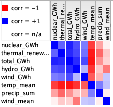
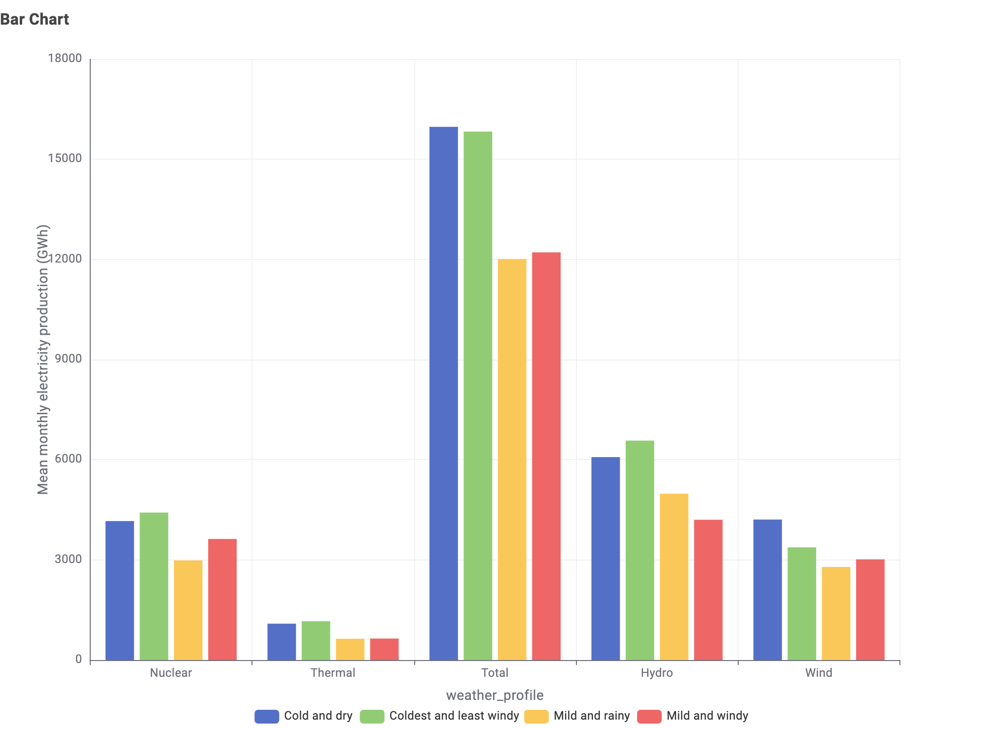

# Weather and Energy Production in Sweden

**Authors:**

- Péter Dávid Hajdu
- Prajval Parthiban
- Christos Zampounis

## Introduction and motivation

In Sweden, energy generation is mostly based on hydropower and wind power, so electricity generation can change with the weather. In our analysis, we attempted to find patterns in the relationship between monthly weather data and electricity production from August 2024 to July 2026.

On average, Sweden generated about 168 TWh of electricity per year during the study period. Almost all electricity in Sweden is generated by low-carbon sources. Hydropower accounts for about 39%, nuclear power for 26%, wind power for 25%, and renewable thermal power for about 6%. These sources vary by season, which is why we performed a month-by-month analysis.

Three variables from the SMHI dataset were chosen as follows:

- Temperature, since low temperature increases heating demand and therefore increases electricity consumption.
- Precipitation, since it provides water for hydropower generation.
- Wind speed, since it affects how much electricity wind turbines can produce.

Sunshine duration was not taken into account, as it is mainly relevant for solar energy.

The weather stations selected represent different regions of Sweden. Stockholm is a major consumption centre, and Göteborg is located on the windy west coast. Malmö stands for the southern part of Sweden, where wind and solar generation are relevant, while Luleå represents the northern part, where hydropower is important. The 24 months cover two full years, so the seasons can be compared.

## Method

Figure 1 shows the complete KNIME workflow. It runs from data download to clustering with no manual steps.

**Figure 1. Complete KNIME workflow**

### Weather data

We used data from the SMHI Meteorological Observations API in the form of one quality-controlled CSV file per station and per variable. In the configuration table, there is information about 12 series: 4 stations × 3 variables. A loop creates a URL for each and downloads the file.

We selected data from the study period and checked for duplicates and inconsistent values. There were none. To be included, a station-month needed at least 90% of its values. Four Malmö station-months did not satisfy this requirement, and they were removed rather than imputed. For each station, we computed the monthly mean, minimum, maximum and standard deviation, and for precipitation also the monthly total and number of wet days. We then averaged these values across the stations with equal weight.

### Energy data and join

Monthly electricity production in GWh came from SCB table TAB5644 through the current PxWebApi v2. We used five categories: total, hydro, nuclear, wind and renewable thermal power. Solar and non-renewable thermal were excluded because they are very small. The workflow sends one request per category, with the period and category codes stored in a configuration table, and reads the unit (GWh) from the response. The result has one row per month, with the month converted from `2024M08` to `2024-08`. Checks confirmed 24 months, no duplicates, no missing values, and five categories with 24 months each. The weather and energy tables were joined on month, and all 24 months matched on both sides.

### Clustering

Every month was treated as a single data point characterised by three variables: mean temperature, total precipitation, and mean wind speed. Complete data were available for all 24 months. Because the variables were measured in different units, they were transformed into z-scores so that each would receive equal weighting. A hierarchical cluster analysis was conducted using Euclidean distance and average linkage. The dendrogram (Figure 2) reveals a distinct gap in the range where the clusters merge, between 2.0 and 2.3. Four clusters were obtained by cutting the tree at this point. For each cluster, the mean weather values and the mean electricity production were subsequently computed.

**Figure 2. Hierarchical clustering dendrogram**

## Results and discussion

### Weather and energy

In Figures 3 and 4, each point is one month, coloured by season (winter is December to February, and so on).

**Figure 3. Wind speed vs wind power (scatter)**

Figure 3 shows only a weak link between wind speed and wind power (r ≈ 0.2). Wind speed varies only from 2.4 to 3.5 m/s, while production ranges from 1,500 to 5,500 GWh and is lowest in summer. The stations also measure wind 10 m above ground near cities, whereas most wind farms are inland at 100 m or higher.

**Figure 4. Temperature vs total production (scatter)**

Figure 4 shows a strong negative link (r ≈ −0.93). Cold months produce 15,800 to 18,300 GWh and warm months 10,500 to 12,900 GWh. Demand for heating and lighting rises in winter, and production follows demand.

**Figure 5. Production by type over time (line)**

Figure 5 shows the seasonal cycle. Total production peaks every January and is lowest in summer. Hydropower also peaks in winter, because reservoirs store water and release it when demand is high, so monthly rainfall barely affects it. Nuclear output drops each summer during planned maintenance.

**Figure 6. Correlations (heatmap; blue = positive, red = negative)**

Figure 6 summarises all pairs. Temperature correlates strongly and negatively with every source (r = −0.64 to −0.93), while precipitation shows only weak links. Wind speed is negatively linked to hydropower (r ≈ −0.5), possibly because less hydropower is used when wind power is available.

### Clustering

**Table 1. Number of months, mean weather conditions, and mean monthly electricity production by cluster**

| Weather profile         | Months | Mean temperature (°C) | Mean monthly precipitation (mm) | Mean wind speed (m/s) | Mean total monthly production (GWh) |
| ----------------------- | -----: | --------------------: | ------------------------------: | --------------------: | ----------------------------------: |
| Cold and dry            |      9 |                  2.77 |                           36.10 |                  3.06 |                              15,971 |
| Coldest and least windy |      3 |                 −1.10 |                           34.15 |                  2.55 |                              15,829 |
| Mild and rainy          |      9 |                 14.52 |                           68.85 |                  2.90 |                              12,013 |
| Mild and windy          |      3 |                 14.46 |                           53.14 |                  3.45 |                              12,211 |

**Figure 7. Mean monthly electricity production by weather cluster (GWh)**

Table 1 and Figure 7 show that the two cold clusters produced about 4,000 GWh more per month than the two mild clusters, matching the seasonal pattern above. Two clusters contain only three months each, so their averages are sensitive to single months.

### Data quality and limitations

- With only 24 months, the correlations are uncertain, and season drives most of the patterns, so the results show associations, not causes.
- Four equally weighted stations cannot represent all of Sweden or where power plants are located.
- Four Malmö station-months were left out because they had too little data. SMHI also uses UTC times and a 06:00 to 06:00 precipitation day, which can shift small amounts of data between months.
- Production also depends on demand, exports, prices and maintenance, none of which are in the data.
